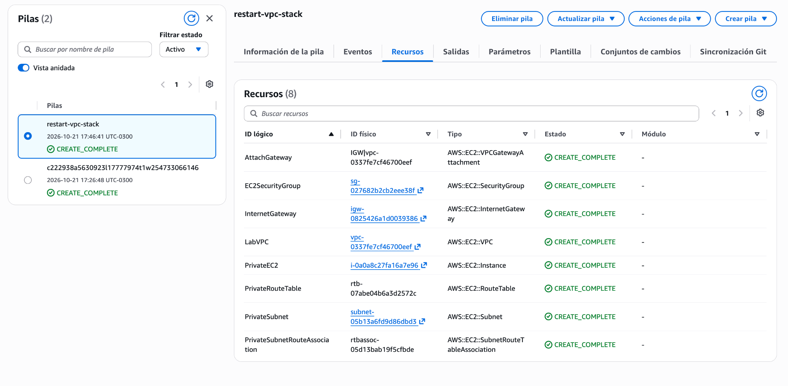
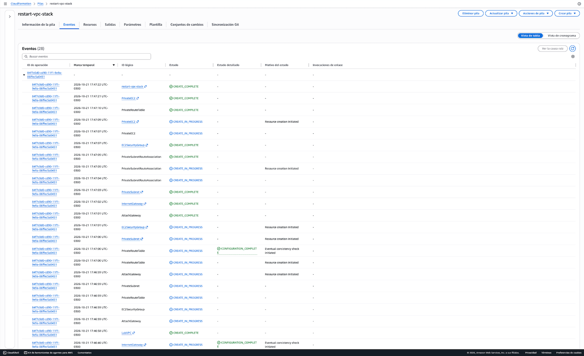
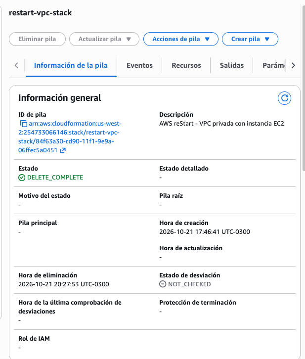

# AWS CloudFormation – Private VPC and EC2 Infrastructure

**Infrastructure as Code | AWS Networking | Amazon EC2 | AWS re/Start**

## Project Overview

This project demonstrates the provisioning and management of AWS cloud infrastructure using AWS CloudFormation.

Developed as part of an AWS re/Start hands-on challenge, the project focuses on creating a custom Virtual Private Cloud (VPC), configuring private networking components, and deploying an Amazon EC2 instance using a declarative YAML template.

The infrastructure was successfully deployed through the AWS Management Console, and all eight CloudFormation resources reached `CREATE_COMPLETE`.

The stack was subsequently deleted, reaching `DELETE_COMPLETE`.

This repository documents the infrastructure architecture, deployment procedure, verification evidence, security considerations, and cleanup process.

## Project Objectives

- Define AWS infrastructure using Infrastructure as Code (IaC).
- Create a custom VPC and private subnet.
- Configure an Internet Gateway and private route table.
- Deploy an Amazon EC2 instance without an automatically assigned public IP address.
- Configure a security group according to the laboratory requirements.
- Verify infrastructure provisioning through AWS CloudFormation.
- Document the deployment and cleanup lifecycle.

## Architecture

The infrastructure is defined in `template.yaml` and deployed in the AWS `us-west-2` region.

| Resource | Configuration |
|---|---|
| Amazon VPC | `10.0.0.0/16` |
| Internet Gateway | Created and attached to the VPC |
| Private Subnet | `10.0.1.0/24` |
| Availability Zone | First available AZ returned by CloudFormation |
| Private Route Table | Local VPC route only |
| Subnet Route Table Association | Associates the private subnet with its dedicated route table |
| Security Group | Inbound SSH (TCP 22) from `0.0.0.0/0` |
| Amazon EC2 | `t3.micro`, Amazon Linux 2023 |
| Public IP Assignment | Disabled for the private subnet |

The CloudFormation template defines eight resources, including the Internet Gateway attachment and subnet route table association.

### Architecture Diagram

See [Architecture Documentation](architecture.md) for the infrastructure diagram and networking details.

### Network Design

The VPC uses the CIDR block `10.0.0.0/16`, with a private subnet using `10.0.1.0/24`.

An Internet Gateway is attached to the VPC. However, the private subnet's route table does not include a default route (`0.0.0.0/0`) to the Internet Gateway.

The EC2 instance is deployed in the private subnet, with automatic public IP assignment disabled.

Consequently, the instance does not have direct public internet connectivity through the deployed network configuration.

The Internet Gateway attachment alone does not make the private subnet publicly accessible.

## Repository Structure

```text
aws-cloudformation-vpc-ec2/
├── README.md
├── template.yaml
├── reto-cloudformation.yaml
├── architecture.md
└── evidence/
    ├── cloudformation-resources.png
    ├── cloudformation-events.png
    └── cloudformation-delete-complete.png
```

**File descriptions:**

- `template.yaml`: Reviewed CloudFormation template used to document and reproduce the architecture.
- `reto-cloudformation.yaml`: Original laboratory template.
- `architecture.md`: Infrastructure diagram and networking explanation.
- `evidence/`: Screenshots documenting the original deployment and stack deletion.

The reviewed `template.yaml` preserves the infrastructure resource definitions from the original laboratory template, with documentation-related improvements.

## Deployment

### Prerequisites

- An AWS account with appropriate permissions.
- Access to the AWS Management Console.
- Permissions to create CloudFormation, VPC, EC2, and related networking resources.
- Access to the public Amazon Linux 2023 AMI parameter through AWS Systems Manager Parameter Store.

AWS charges may apply when reproducing this project outside a training environment.

### Deployment Procedure

1. Sign in to the AWS Management Console.
2. Select the `us-west-2` region.
3. Navigate to **AWS CloudFormation**.
4. Choose **Create stack → With new resources (standard)**.
5. Select **Upload a template file**.
6. Upload `template.yaml`.
7. Enter a stack name, such as `restart-vpc-stack`.
8. Review the template parameters and stack configuration.
9. Submit the stack.
10. Monitor the **Events** tab until the deployment finishes.
11. Confirm that the stack reaches `CREATE_COMPLETE`.
12. Review the **Resources** and **Outputs** tabs.

### Original Deployment

The laboratory infrastructure was deployed through the AWS CloudFormation Management Console.

| Property | Result |
|---|---|
| Stack name | `restart-vpc-stack` |
| Region | `us-west-2` |
| Deployment date | October 21, 2026 |
| Stack status | `CREATE_COMPLETE` |
| Resources provisioned | 8 |
| Resource status | All eight reached `CREATE_COMPLETE` |

The deployment was completed using the AWS Management Console. A successful AWS CLI deployment is not claimed.

## Deployment Evidence

### 1. Provisioned Resources



The CloudFormation Resources tab shows the eight infrastructure resources with `CREATE_COMPLETE` status.

These include the VPC, Internet Gateway, gateway attachment, private subnet, route table, subnet route table association, security group, and EC2 instance.

### 2. Deployment Events



The CloudFormation Events tab shows the provisioning sequence and confirms that the stack reached `CREATE_COMPLETE`.

The event history includes successful creation of the EC2 instance and supporting networking resources.

## Validation

The deployment and cleanup were verified through the AWS CloudFormation Management Console.

### Deployment Verification

The following results were confirmed:

- The stack `restart-vpc-stack` reached `CREATE_COMPLETE`.
- All eight resources reached `CREATE_COMPLETE`.
- The Events tab recorded the successful resource creation sequence.
- The provisioned resource types corresponded to the infrastructure defined in the laboratory template.

### Cleanup Verification

The following results were confirmed:

- The stack was deleted on October 21, 2026.
- The final CloudFormation status was `DELETE_COMPLETE`.
- The deletion result was verified in the CloudFormation console.

### Verification Limitations

The available evidence confirms successful CloudFormation provisioning and stack deletion.

The following additional checks were not independently performed or documented:

- Successful AWS CLI template validation.
- EC2 instance connectivity testing.
- Independent verification of the deployed subnet's effective routing configuration.
- Independent verification of the EC2 instance's public IP configuration.
- Independent resource inventory after stack deletion.

The network configuration described in this repository is based on the CloudFormation template. It should not be interpreted as proof of independently tested connectivity or network behavior.

## Security Considerations

### SSH Access

The laboratory requires a security group allowing inbound SSH traffic on TCP port 22 from `0.0.0.0/0`.

This configuration is intentionally retained in the template to accurately represent the original exercise.

**Allowing SSH from any IPv4 address is not recommended for production environments.**

In a production implementation, access should be restricted to trusted sources or replaced with a more controlled administrative access method, such as AWS Systems Manager Session Manager where supported.

### Private Networking

The EC2 instance is deployed in a private subnet without automatic public IP assignment.

The subnet's route table does not contain a default route to the Internet Gateway.

Although the security group allows inbound SSH, this rule alone does not provide public connectivity to the EC2 instance.

### IAM and Least Privilege

Infrastructure deployment requires appropriate IAM permissions.

For production workloads, IAM policies should follow the principle of least privilege, granting only the permissions required to provision and manage the necessary resources.

### Production Considerations

This project is a foundational training exercise, not a production-ready infrastructure deployment.

Potential improvements for a production environment include:

- Restricting administrative access.
- Implementing controlled private-instance management.
- Adding appropriate monitoring and logging.
- Defining additional network security controls.
- Reviewing availability, resilience, and operational requirements.

These improvements are recommendations and are not claimed as implemented in the current project.

## Cleanup

The CloudFormation stack was deleted through the AWS Management Console after the laboratory deployment.

| Property | Result |
|---|---|
| Stack name | `restart-vpc-stack` |
| Region | `us-west-2` |
| Creation date | October 21, 2026 |
| Deletion date | October 21, 2026 |
| Final status | `DELETE_COMPLETE` |

### Cleanup Evidence



The screenshot confirms that CloudFormation completed the deletion of the stack.

### Cleanup Procedure

To remove infrastructure deployed using this template:

1. Open the AWS CloudFormation console.
2. Navigate to **Stacks**.
3. Select the deployed stack.
4. Choose **Delete**.
5. Confirm the deletion.
6. Monitor the deletion events.
7. Verify that the stack reaches `DELETE_COMPLETE`.

Stack deletion helps prevent unnecessary resource usage and potential AWS charges.

Although CloudFormation reported successful stack deletion, an independent inventory of remaining AWS resources was not performed.

## Technologies Used

- AWS CloudFormation
- Amazon Virtual Private Cloud (VPC)
- Amazon Elastic Compute Cloud (EC2)
- Internet Gateway
- Security Groups
- VPC Route Tables
- AWS Systems Manager public AMI parameter
- YAML
- Infrastructure as Code (IaC)

## Learning Outcomes

Through this project, I gained practical experience in:

- Defining AWS infrastructure declaratively using CloudFormation.
- Understanding the relationship between VPCs, subnets, Internet Gateways, and route tables.
- Deploying an EC2 instance in a private subnet.
- Identifying how security groups and routing affect network accessibility.
- Reviewing CloudFormation resource and event information.
- Understanding the importance of deployment verification and resource cleanup.
- Documenting infrastructure architecture, security considerations, and operational limitations.

## Project Context

This project was developed as part of AWS re/Start training and documented as a practical demonstration of foundational AWS cloud infrastructure knowledge.

It is intended to support a junior-level portfolio focused on Cloud Support, Cloud Infrastructure, and Infrastructure as Code.