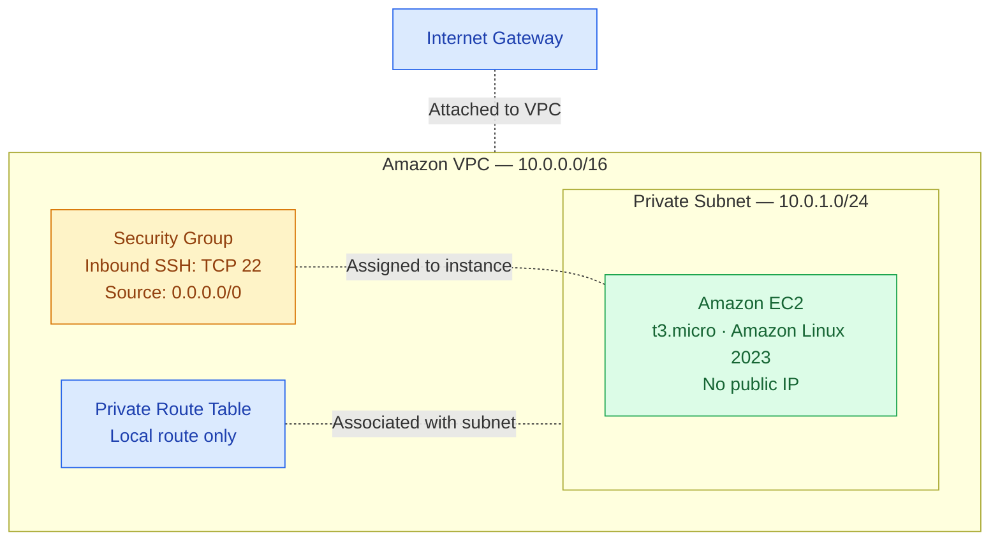

# AWS Network Architecture

This diagram represents the AWS infrastructure defined in the CloudFormation template.

## Network Configuration

| Component | Configuration |
|---|---|
| VPC | `10.0.0.0/16` |
| Private Subnet | `10.0.1.0/24` |
| Internet Gateway | Attached to the VPC |
| Private Route Table | Local VPC route only |
| EC2 Instance | `t3.micro`, Amazon Linux 2023 |
| Public IP | Not automatically assigned |
| Security Group | TCP port 22 from `0.0.0.0/0` |

## Network Behavior

The Internet Gateway is attached to the VPC, but the private subnet does not have a default route to it.

As a result, the EC2 instance does not have direct internet connectivity through the deployed network configuration.

The security group permits inbound SSH traffic from any IPv4 address, as required by the laboratory. However, this rule does not make the private instance publicly accessible.

The diagram describes the intended infrastructure configuration defined in the CloudFormation template. Independent connectivity testing was not performed.

## Security Considerations

The SSH rule allowing traffic from `0.0.0.0/0` is retained to match the original laboratory requirements.

For production environments, administrative access should be restricted to trusted sources or managed through an appropriate secure access mechanism.
